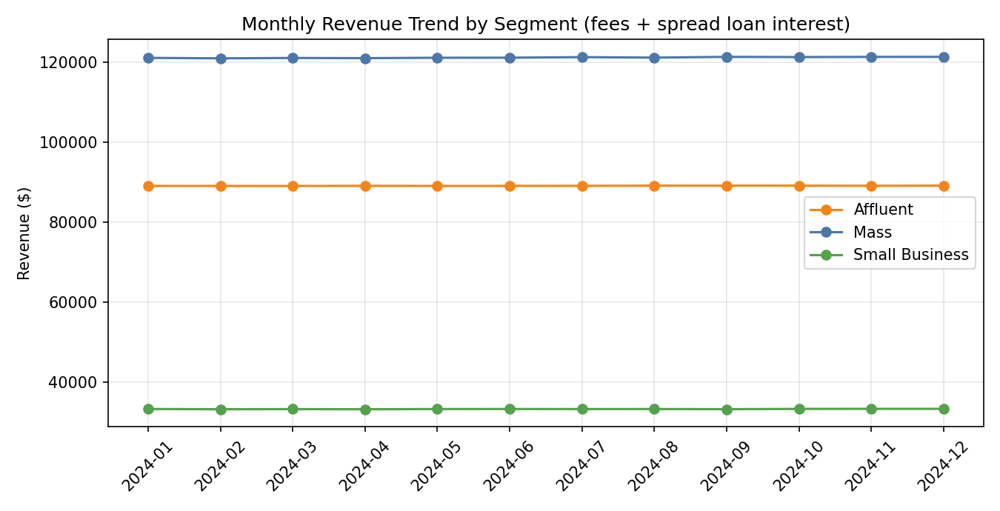
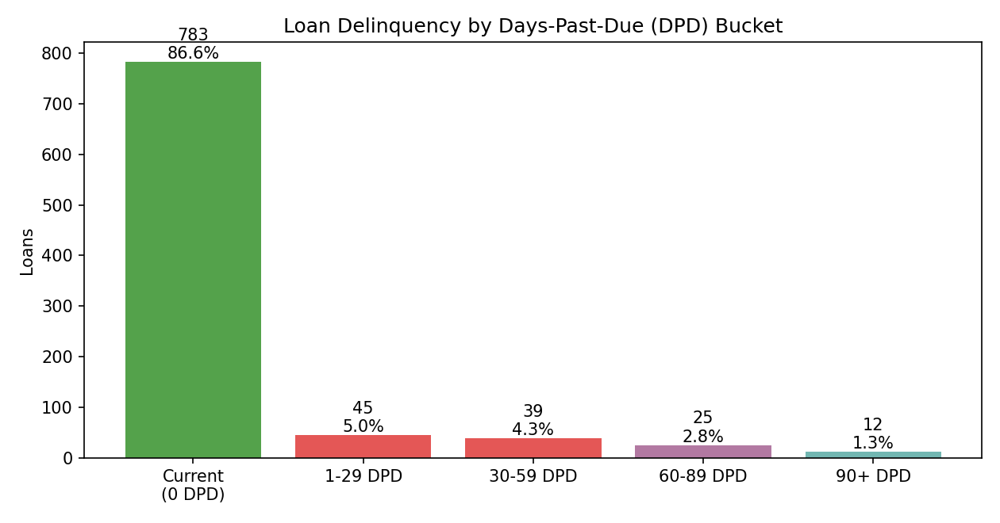
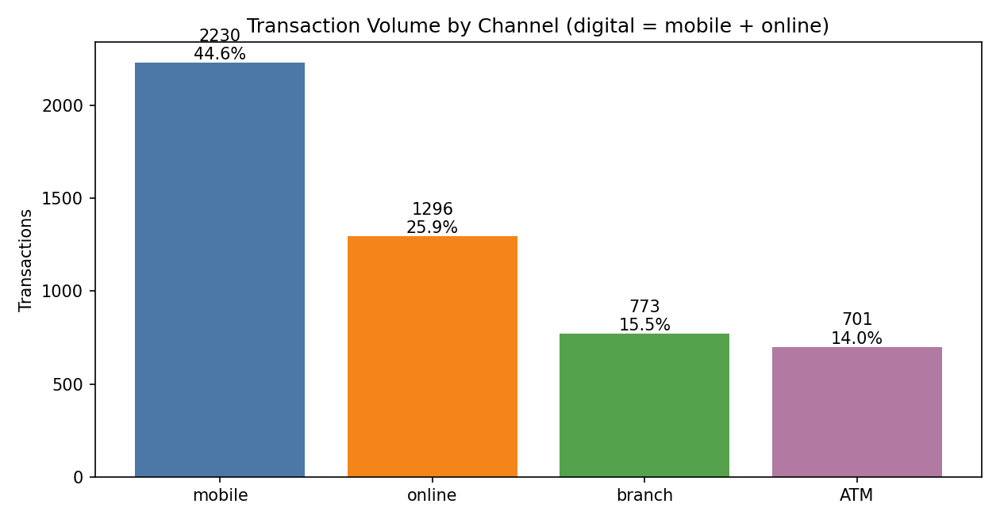
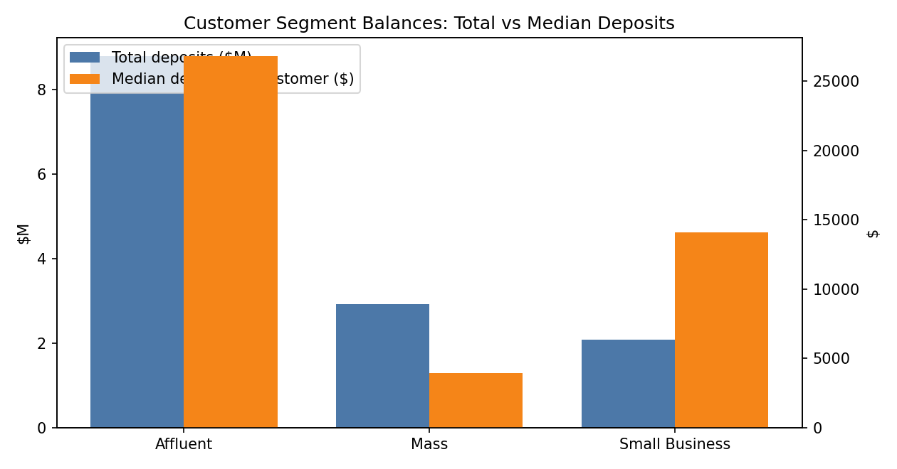

# Banking Customer and Revenue Analytics: Deposits, Loan Risk and Digital Adoption

## In simple words — what is this project?

This project is my Bank of America senior data analyst job, done as one project.

I took 5 lists of bank data — customers, accounts, loans and transactions.
I joined them together and cleaned them.
Then I answered the normal questions a bank asks every week:
- How much money do customers keep in the bank? ($13.78 million in deposits)
- Which customers are most valuable? (47.5% of customers use 3 or more bank products)
- How much money does the bank earn? ($2.98 million revenue)
- How many loans are paid late? (8.4% are 30+ days late; for low credit-score customers it is 21.1%)
- How many people use mobile banking? (70.5% of transactions are digital)

Finally I made the monthly KPI report update automatically, so managers get fresh numbers without manual work — the same reporting automation I did in my real job.
Tools used: SQL, Python, AWS, Power BI — the same tools from my 90-day study plan.

     

> **Portfolio project — synthetic data only.** This repo mirrors, end-to-end, what a Senior Data Analyst actually owns at a retail bank (the Bank of America pattern): one data pipeline feeding customer, revenue, risk and channel reporting, finished with an automatically generated executive KPI pack. It is deliberately **not** a single-niche project — breadth across the whole job is the point.

## The 5 modules (one pipeline, five real responsibility areas)

| Module | Responsibility area | What it answers |
|---|---|---|
| 0 | Data pipeline & quality | Can we trust the data? Ingestion, cleaning, modelling, 14 automated quality checks |
| 1 | Customer 360 & segmentation | Who are our customers? Segments, holdings depth, balances |
| 2 | Revenue & product performance | Where does money come from? Interest + fees by product, segment, month |
| 3 | Credit risk | Where is the book hurting? DPD buckets, charge-off proxy, risk by credit band |
| 4 | Transactions & channels | How do customers bank? Channel mix, digital adoption, monthly actives |
| 5 | Automated KPI pack | Can reporting run itself? `analysis.py` writes the executive summary automatically |

## Headline KPIs (actual values — regenerate with the run steps below)

| KPI | Value |
|---|---|
| Customers / Accounts / Loans / Transactions | 800 / 1,453 / 904 / 5,000 |
| Total deposits | $13,780,469 |
| Total revenue (interest + fees) | $2,982,737 |
| Loan interest revenue / Fee revenue | $2,911,566 / $71,171 |
| Largest revenue segment (total) | Mass — $1,454,008 |
| Top segment by revenue per customer | Affluent — $5,509 |
| Deep-relationship rate (3+ product types) | 47.5% |
| Accounts per customer | 1.82 |
| Delinquency rate (30+ DPD) | 8.41% |
| Charge-off proxy (90+ DPD) | 1.33% |
| Worst credit band | Poor (<600) — 21.05% delinquent |
| Digital adoption share (mobile + online) | 70.52% |
| Monthly active customers, Jan → Dec 2024 | 271 → 401 |
| Data-quality checks fully clean (Module 0) | 14 / 14 |

## Dashboard






## Key insights by module

- **Module 1 — Customer 360:** 47.5% of customers hold 3+ product types; the other half is the cross-sell opportunity, concentrated in single-product Mass customers. Affluent customers are 24% of the base but hold a disproportionate share of deposits (see `outputs/segment_summary.csv`).
- **Module 2 — Revenue:** Interest dominates ($2.91M of $2.98M) and mortgages are the largest product line. Mass wins on total revenue through volume; Affluent wins per customer ($5,509) — the two facts drive different strategies.
- **Module 3 — Credit risk:** Headline delinquency of 8.41% hides the concentration: the Poor (<600) band runs at 21.05%, roughly 2.5× the book average. Limit reviews and pricing attention belong there, not spread evenly.
- **Module 4 — Channels:** Digital carries 70.52% of transactions (mobile alone is the top channel), and monthly actives grew 271 → 401 across 2024 — branch capacity planning should follow the mix, not the headline count.
- **Module 0/5 — Trust & automation:** All 14 data-quality checks pass on the synthetic book, and the entire pack — including this KPI table's source file, `outputs/kpi_pack.md` — regenerates from one command.

## Data files (all in `data/`)
- `customers.csv` — 800 customers: segment (Mass / Affluent / Small Business), age band, region, credit score
- `products.csv` — the bank's 9 products: type, interest rate, yearly fee
- `accounts.csv` — about 1,450 accounts: type (checking / savings / credit card), balance
- `loans.csv` — about 900 loans: amount, balance still owed, days past due (how late the payments are)
- `transactions.csv` — 5,000 transactions from 2024: channel (mobile / online / branch / ATM), type, amount, fee

How the headline numbers are calculated: 30+ DPD rate = share of loans 30 or more days late · Digital adoption = (mobile + online transactions) ÷ all transactions · Revenue = loan interest (balance owed × interest rate) + fees.

## Repository structure

```
├── analysis.py             # Modules 0-5: DQ report, KPIs, insights, KPI pack
├── charts.py               # the 4 dashboard charts
├── data/                   # customers, products, accounts, loans, transactions
├── sql/analysis_queries.sql# 12 commented queries across all modules
├── outputs/                # kpi_summary, segment_summary, product_revenue, kpi_pack
├── images/                 # 4 chart PNGs (dpi=150)
```

## How to run

```bash
pip install -r requirements.txt
python3 analysis.py          # Modules 0-5 -> outputs/
python3 charts.py            # -> images/
```

## SQL highlights (`sql/analysis_queries.sql`)

Segment 360 summary and deep-relationship CTE (Module 1) · revenue share with `SUM() OVER ()` window and monthly trend with `LAG` growth (Module 2) · DPD bucketing with `CASE`, delinquency by credit band and the segment × loan-type risk matrix (Module 3) · channel mix with window share and monthly actives (Module 4) · orphan-key/duplicate data-quality checks (Module 0).

## Interview Q&A

1. **"Walk me through this project."** One pipeline, five modules: quality-checked ingestion of customers/accounts/loans/transactions, then Customer 360, revenue, credit risk and channel reporting, all rolled into an auto-generated executive KPI pack — the same reporting chain a senior banking analyst owns end-to-end.
2. **"How do you define delinquency?"** 30+ days past due as the headline, with the full DPD ladder (current / 1-29 / 30-59 / 60-89 / 90+) behind it, and 90+ as a charge-off *proxy* — a leading indicator, not realised losses.
3. **"Revenue is mostly interest — is that realistic?"** For a mortgage-heavy retail book, yes; the honest part is the assumption register: interest = balance × product rate, spread evenly for the monthly trend, while fee revenue is genuinely transactional.
4. **"Where would you focus risk work?"** Not on the 8.41% average — on the Poor credit band at 21.05% and on the segment × product cells with the worst rates. Averages hide concentration; the matrix finds it.
5. **"What would production add?"** Warehouse tables instead of CSVs, incremental loads, alerting on the Module 0 checks, RLS by region in Power BI, and replacing the charge-off proxy with vintage loss curves once outcome data matures.

## 60-second talk track

"I built the reporting platform I wish I'd had at the bank. One pipeline ingests customers, accounts, loans and transactions, runs fourteen data-quality checks, and then answers the four questions leadership actually asks: who are our customers — that's Customer 360 and segmentation; where does revenue come from — interest and fees by product and segment; where is risk concentrating — DPD buckets and delinquency by credit band, which is 21% in the poor band against a book average of 8.4%; and how are customers banking — seventy percent digital, with monthly actives up from 271 to 401. Then the part I'm proudest of: the executive KPI pack writes itself. One command regenerates every number, so the reporting is reproducible and auditable instead of a spreadsheet someone edited."

## Assumptions & honesty notes

Synthetic seeded data; no real customers. Loan interest uses product rates on outstanding balances and is spread evenly across months for the trend (fees are truly monthly). Charge-off is a 90+ DPD proxy. Credit-card balances are negative (amount owed). "Deep relationship" = 3+ distinct product types — the definition is stated wherever the metric appears.

## Next steps

Vintage/roll-rate analysis for Module 3, cohort retention for Module 1, and a dbt version of the Module 0 pipeline.
