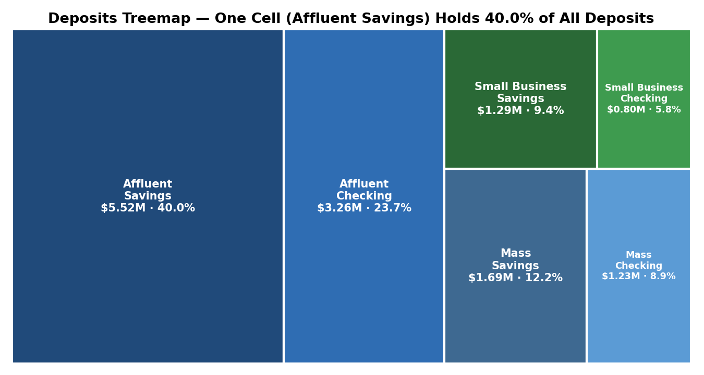
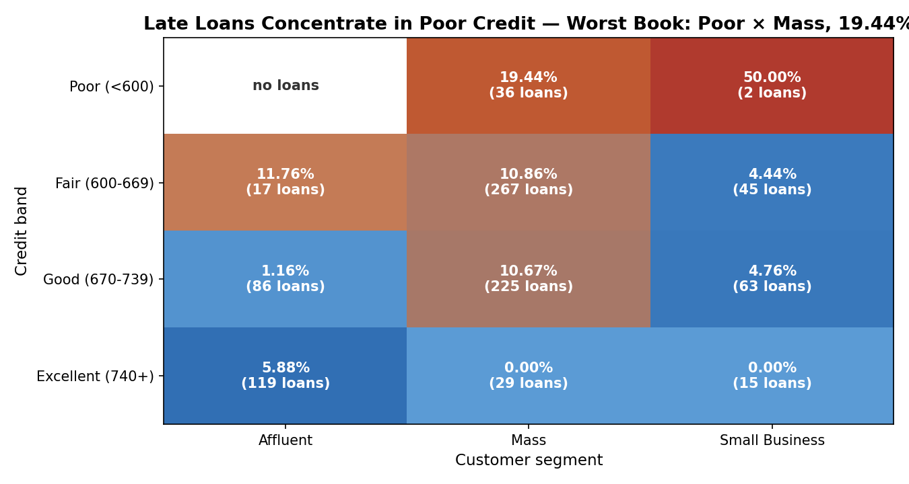
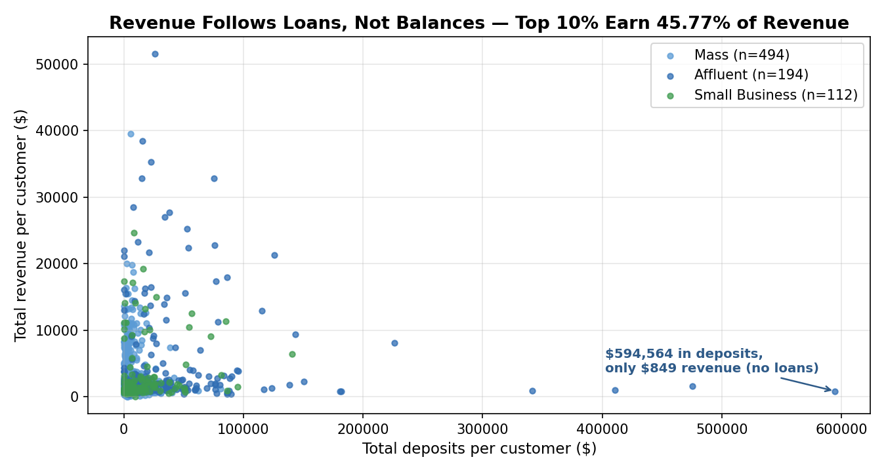
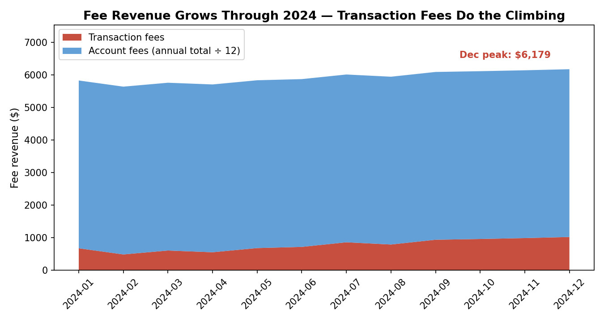
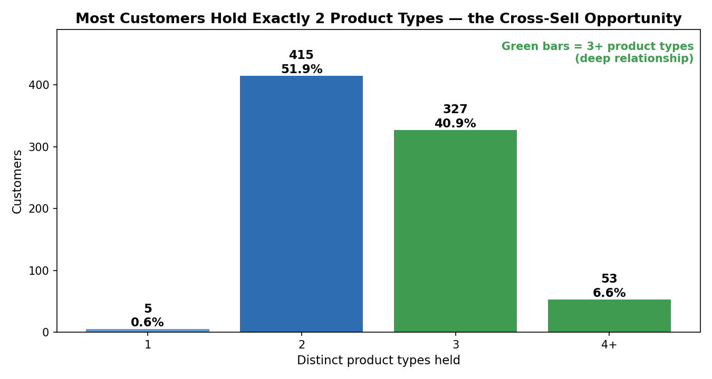
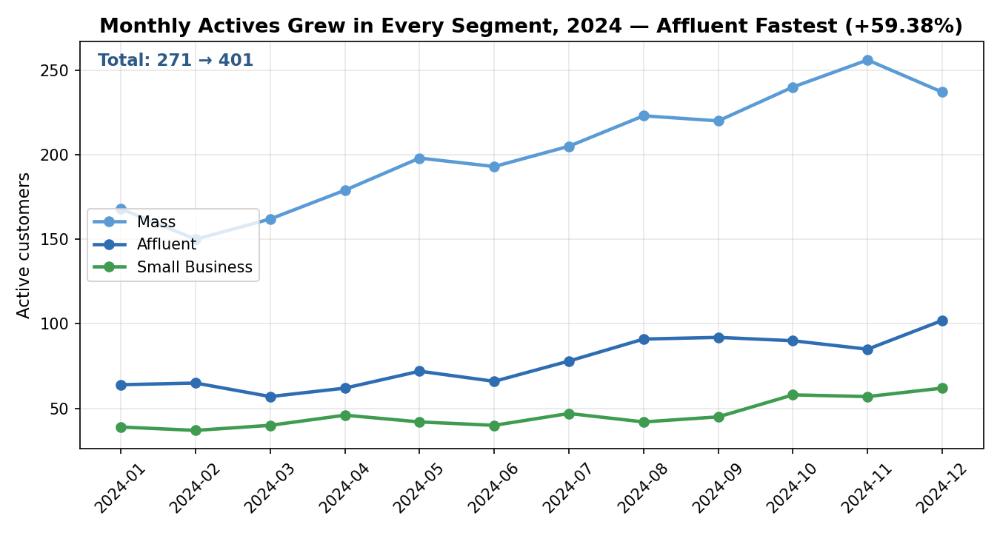

# Customer Accounts & Loans Portfolio Review: Revenue per Customer, Deposit Base & Loan Delinquency

This project is my Bank of America senior data analyst job, done as one project.

I took 5 lists of bank data — customers, accounts, loans, transactions and products — joined them together and cleaned them. Then I answered the normal questions a bank asks every week:

- How much money do customers keep in the bank? ($13.78 million in deposits)
- Which customers are most valuable? (47.5% of customers use 3 or more bank products)
- How much money does the bank earn? ($2.98 million revenue)
- How many loans are paid late? (8.4% are 30+ days late; for low credit-score customers it is 21.1%)
- How many people use mobile banking? (70.5% of transactions are digital)

Finally I made the monthly KPI report update automatically, so managers get fresh numbers without manual work — the same reporting automation I did in my real job. Tools used: SQL, Python, AWS, Power BI.

     

> **Portfolio project — synthetic data only.** This repo mirrors, end-to-end, what a Senior Data Analyst actually owns at a retail bank (the Bank of America pattern): one data pipeline feeding customer, revenue, risk and channel reporting, finished with an automatically generated executive KPI pack. It is deliberately **not** a single-niche project — breadth across the whole job is the point.

## What this project answers

A retail bank's leadership asks the same questions every week, and the answers live in four separate systems that do not agree with each other. This project joins them into one trusted book and answers, in order:

1. Can we trust the data? (duplicates, missing keys, orphan records, impossible values)
2. Who are our customers, and how deep is each relationship?
3. How much money do customers keep with us — and how concentrated is it?
4. Where does revenue come from — which products, which segments, per customer?
5. Where is loan risk concentrating — which credit bands, segments and products?
6. How do customers bank — and is digital behaviour a segment trait or bank-wide?
7. Can the whole report regenerate itself, so next month's pack is one command away?

## Headline KPIs — the 15

| KPI | Value |
|---|---|
| Total deposits | $13,780,469 |
| Total revenue (interest + fees) | $2,982,737 |
| Loan interest revenue | $2,911,566 |
| Fee revenue (transaction + account fees) | $71,171 |
| Revenue per customer — Affluent (top segment) | $5,509 |
| Revenue from top 10% of customers | 45.77% |
| Biggest deposit cell — Affluent savings | 40.04% of all deposits |
| Deep-relationship rate (3+ product types) | 47.5% |
| Customers holding exactly 2 product types | 415 |
| Total loans | 904 |
| Delinquency rate (30+ DPD) | 8.41% |
| Charge-off proxy (90+ DPD) | 1.33% |
| Latest-paying loan product — Mortgage, at 30+ DPD | 11.17% |
| Digital adoption share (mobile + online) | 70.52% |
| Monthly active customers — Dec 2024 | 401 |

Every KPI above is defined in plain words, with its exact formula, in [`KPI_DICTIONARY.md`](KPI_DICTIONARY.md). Supporting detail lives in the breakdown CSVs in `outputs/`.

## Charts

The 10 charts from `charts.py`. The same analysis is also in `dashboard/dashboard.html` — one interactive file with filters, where every number recomputes for the customers you pick.

**Revenue trend by segment:** Mass leads every month; the lines are nearly flat because only the small fee part truly moves month to month.


**Revenue mix donut:** Mortgage interest is 70.51% of all revenue; fees are only 2.39%.


**Deposits treemap:** Affluent savings alone holds 40.04% of all deposits.


**Risk heatmap:** The worst cell with a real book behind it is Poor × Mass at 19.44% late (36 loans); Poor × Small Business shows 50.00%, but that is 1 of only 2 loans.


**Customer value scatter:** Revenue follows loans, not balances — the one customer with $500K+ in deposits earns the bank almost nothing.


**Monthly fee area:** Fee income through 2024; December is the peak month at $6,179.


**Loans by product × DPD bucket:** Mortgages run latest — 11.17% are 30+ days late, against 7.52% for auto and 7.79% for personal loans.


**Digital adoption by segment:** Every segment sits between 70.49% and 70.62% — digital is bank-wide, not a segment trait.


**Customers by products held:** Most customers (415 of 800) hold exactly 2 product types; 380 hold 3 or more.


**Monthly actives by segment:** Monthly active customers grew from 271 to 401 during 2024, in every segment.


## Key findings

1. **Risk is concentrated, not spread** — the book's 8.41% late rate (KPI 11) hides the Poor credit band at 21.05%; the heatmap shows the worst real pocket is Poor × Mass (19.44%, 36 loans).
2. **Mortgages run latest** — 11.17% at 30+ DPD (KPI 13), against 7.52% auto and 7.79% personal (loans-by-product chart).
3. **Deposits sit in one cell** — Affluent savings holds 40.04% of all deposits (KPI 7, treemap): a funding strength and a concentration risk.
4. **Value is top-heavy** — the top 10% of customers generate 45.77% of revenue (KPI 6), and the scatter proves revenue follows loans, not balances.
5. **The cross-sell base is two-product customers** — 415 customers hold exactly 2 product types (KPI 9); the 47.5% deep-relationship rate (KPI 8) is carried by the exactly-3 group.
6. **Digital is bank-wide, not a segment trait** — 70.52% overall (KPI 14) and flat by segment (70.49%–70.62%), so one channel strategy fits all.

## How to run

```bash
pip install -r requirements.txt
python3 generate_data.py     # build the 5 source tables
python3 analysis.py          # data checks, KPIs, insights, KPI pack -> outputs/
python3 charts.py            # -> images/
python3 dashboard/build_data.py  # rebuild the interactive dashboard
python3 tests/test_kpis.py   # PASS
```

## Repository structure

```
├── README.md / LICENSE / requirements.txt
├── KPI_DICTIONARY.md       # every KPI: plain-words meaning + exact formula
├── generate_data.py        # seeded synthetic source data (5 tables)
├── analysis.py             # data-quality checks, KPIs, insights, KPI pack
├── charts.py               # the 10 charts
├── data/                   # customers, products, accounts, loans, transactions
├── sql/                    # analysis_queries.sql — 12 commented queries
├── outputs/                # kpi_summary.csv and the breakdown tables
├── images/                 # 10 chart PNGs
└── dashboard/              # dashboard.html (interactive, with filters)
```

## Data

Five tables, all joined on `customer_id`.

| Table | Rows |
|---|---:|
| `customers` | 800 |
| `accounts` | 1,453 |
| `loans` | 904 |
| `transactions` | 5,000 |
| `products` | 9 |

Honest limitations:

- **Synthetic data only** — made by my own script with a fixed seed (42), so every run gives the same data. No real Bank of America data is used or implied.
- **Two revenue bases** — segment revenue is loan interest + transaction fees; per-customer revenue also includes each customer's account fees. Both are stated wherever used.
- **Interest is a snapshot calculation** — loan balance × product rate, spread evenly across months for the trend; only fees truly move month to month.
- **Charge-off is a proxy** — the 90+ DPD share stands in for write-offs; there are no outcome or recovery records behind it.
