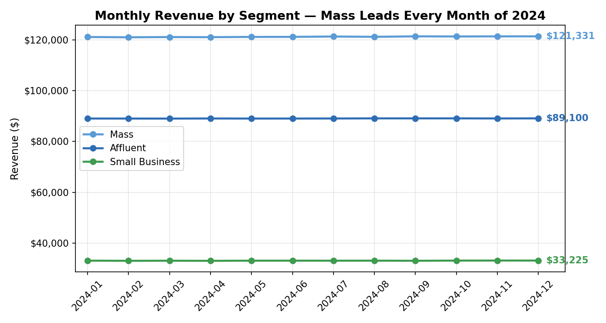
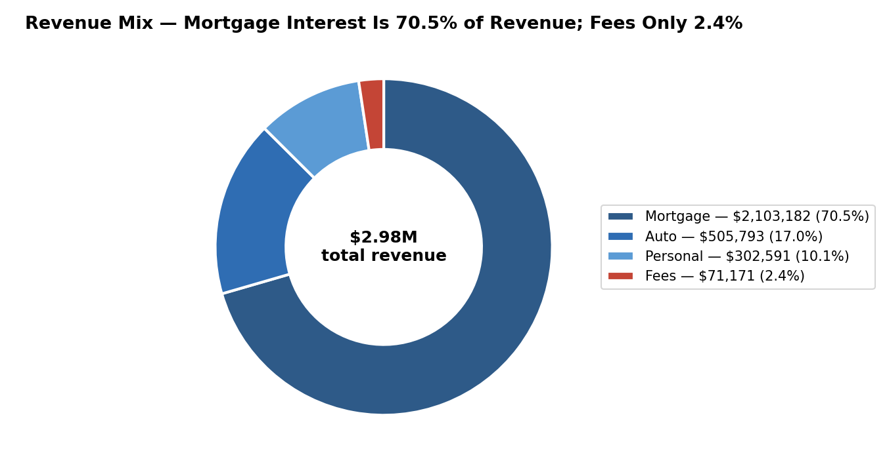
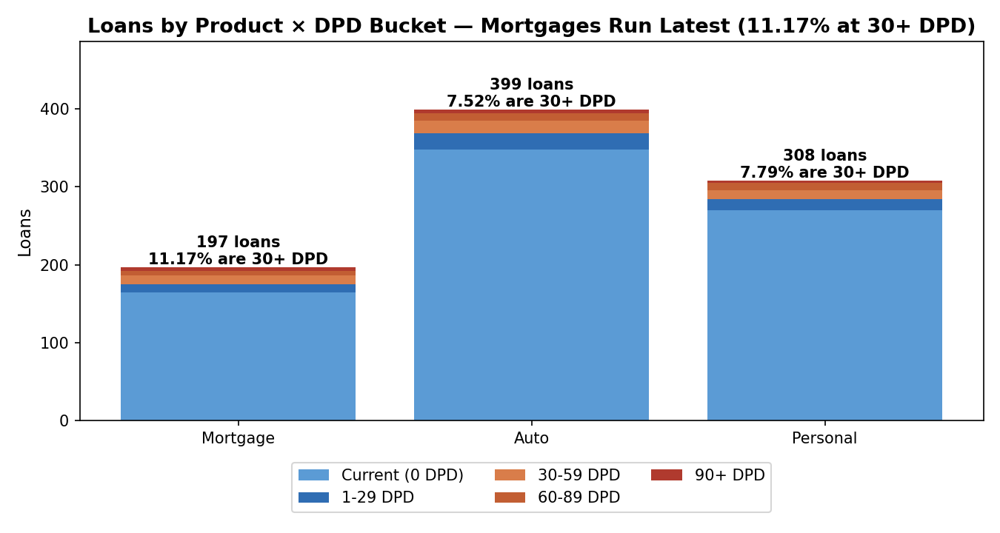
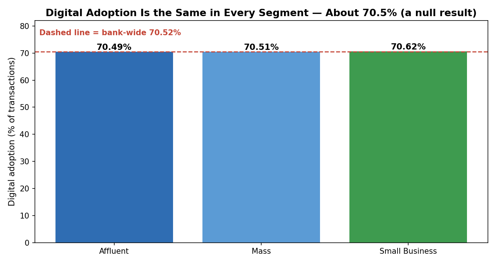

# Banking Customer and Revenue Analytics: Deposits, Loan Risk and Digital Adoption

## In simple words — what is this project?

This project is my Bank of America senior data analyst job, done as one project.

I took 5 lists of bank data — customers, accounts, loans and transactions.
I joined them together and cleaned them.
Then I answered the normal questions a bank asks every week:
- How much money do customers keep in the bank? ($13.78 million in deposits)
- Which customers are most valuable? (47.5% of customers use 3 or more bank products)
- How much money does the bank earn? ($2.98 million revenue)
- How many loans are paid late? (8.4% are 30+ days late; for low credit-score customers it is 21.1%)
- How many people use mobile banking? (70.5% of transactions are digital)

Finally I made the monthly KPI report update automatically, so managers get fresh numbers without manual work — the same reporting automation I did in my real job.
Tools used: SQL, Python, AWS, Power BI — the same tools from my 90-day study plan.


     

> **Portfolio project — synthetic data only.** This repo mirrors, end-to-end, what a Senior Data Analyst actually owns at a retail bank (the Bank of America pattern): one data pipeline feeding customer, revenue, risk and channel reporting, finished with an automatically generated executive KPI pack. It is deliberately **not** a single-niche project — breadth across the whole job is the point.

## The problem

A retail bank's leadership asks the same questions every week, and the answers live in four separate systems that do not agree with each other. This project joins them into one trusted book and answers, in order:

1. Can we trust the data? (duplicates, missing keys, orphan records, impossible values)
2. Who are our customers, and how deep is each relationship?
3. How much money do customers keep with us — and how concentrated is it?
4. Where does revenue come from — which products, which segments, per customer?
5. Where is loan risk concentrating — which credit bands, segments and products?
6. How do customers bank — and is digital behaviour a segment trait or bank-wide?
7. Can the whole report regenerate itself, so next month's pack is one command away?

## Project map — what's inside

- ✅ **Data** — 5 seeded tables (customers, accounts, loans, transactions, products), dictionary below
- ✅ **Data quality** — 14 automated checks (Module 0), all clean, report regenerated every run
- ✅ **Method** — 7 modules, one pipeline (`analysis.py`); SQL twin in `sql/`
- ✅ **15 headline KPIs** — defined in `KPI_DICTIONARY.md`, values in `outputs/kpi_summary.csv`
- ✅ **10 charts** — gallery below, each with its finding in plain words
- ✅ **Interactive dashboard** — `dashboard/dashboard.html`: filters recompute every card, chart and table
- ✅ **Findings & recommendations** — numbered sections below, tied to KPIs and charts
- ✅ **Honest limitations** — synthetic data and every assumption stated, below
- ✅ **How to run** — one-command rebuild + plain-python tests (`tests/test_kpis.py` → PASS)

## The modules (one pipeline, five real responsibility areas + a depth pack)

| Module | Responsibility area | What it answers |
|---|---|---|
| 0 | Data pipeline & quality | Can we trust the data? Ingestion, cleaning, modelling, 14 automated quality checks |
| 1 | Customer 360 & segmentation | Who are our customers? Segments, holdings depth, balances |
| 2 | Revenue & product performance | Where does money come from? Interest + fees by product, segment, month |
| 3 | Credit risk | Where is the book hurting? DPD buckets, charge-off proxy, risk by credit band |
| 4 | Transactions & channels | How do customers bank? Channel mix, digital adoption, monthly actives |
| 5 | Automated KPI pack | Can reporting run itself? `analysis.py` writes the executive summary automatically |
| 6 | Depth pack — new cuts of the same book | What do the averages hide? Deposits treemap, credit-band × segment risk heatmap, per-customer value scatter, revenue-mix donut, monthly fee area chart |
| 7 | Second depth pass — product risk, segment digital & actives | Which loan product runs latest? Is digital a segment trait? Who is growing? Loans by product × DPD bucket, revenue per customer by segment, digital adoption by segment, products-held histogram, monthly actives by segment |

## Headline KPIs — the 15 (actual values — regenerate with the run steps below)

| KPI | Value |
|---|---|
| Total deposits | $13,780,469 |
| Total revenue (interest + fees) | $2,982,737 |
| Loan interest revenue | $2,911,566 |
| Fee revenue (transaction + account fees) | $71,171 |
| Revenue per customer — Affluent (top segment) | $5,509 |
| Revenue from top 10% of customers | 45.77% |
| Biggest deposit cell — Affluent savings | 40.04% of all deposits |
| Deep-relationship rate (3+ product types) | 47.5% |
| Customers holding exactly 2 product types | 415 |
| Total loans | 904 |
| Delinquency rate (30+ DPD) | 8.41% |
| Charge-off proxy (90+ DPD) | 1.33% |
| Latest-paying loan product — Mortgage, at 30+ DPD | 11.17% |
| Digital adoption share (mobile + online) | 70.52% |
| Monthly active customers — Dec 2024 | 401 |

Every KPI above is defined in plain words, with its exact formula, in [`KPI_DICTIONARY.md`](KPI_DICTIONARY.md). Supporting detail (segment totals, credit-band rates, channel mix, monthly series) lives in the breakdown CSVs in `outputs/`.

## Dashboard

Open [`dashboard/dashboard.html`](dashboard/dashboard.html) — a **working interactive dashboard** in one self-contained file (no libraries, works offline from disk). It carries the 15 KPI cards, three live charts and a segment table, and **every number recomputes on the population you filter to**, using the same formulas as `analysis.py`. Its filters:

- **Segment chips (multi-select)** — Affluent / Mass / Small Business, any combination
- **Credit band dropdown** — All / Poor (<600) / Fair (600–669) / Good (670–739) / Excellent (740+)
- **Loan product dropdown** — All / Mortgage / Auto / Personal (selects the loan book: loan KPIs, the DPD chart and loan interest follow it)
- **Month range (From / To)** — drives the monthly-actives chart and the actives KPI card

Unfiltered, the dashboard reproduces the published 15 KPIs exactly; filtered, it answers questions like "Poor band only" or "Mortgages only" live. Rebuild it any time with `python3 dashboard/build_data.py` (it re-embeds the data from `data/`). The static chart gallery below is the same analysis as images. The Power BI build (star schema, 5 pages, DAX) is specified in [`dashboard/dashboard_spec.md`](dashboard/dashboard_spec.md).

**Revenue trend by segment — Mass leads every month:** monthly revenue per segment (that month's fees + the year's interest spread evenly). Mass stays on top all year; the lines are nearly flat because only the small fee part truly moves month to month.


**Revenue mix donut — where the money comes from, in one ring:** mortgage interest is 70.51% of all revenue; fees are only 2.39%.


**Deposits treemap — where the deposit money sits:** each box is one segment × account-type group, sized by dollars. Affluent savings alone holds 40.04% of all deposits.


**Risk heatmap — late loans by credit band and segment together:** the redder the box, the worse the late rate (loan counts printed in every box). Poor credit × Small Business shows 50.00%, but that is 1 of only 2 loans — the worst cell with a real book behind it is Poor × Mass at 19.44% (36 loans). Poor × Affluent has no loans at all.


**Customer value scatter — one dot per customer, deposits vs revenue:** big deposits do not always mean big revenue. The one customer with $500K+ in deposits earns the bank almost nothing, while others earn $20K+ on small deposits — because revenue follows loans, not balances.


**Monthly fee area — fee income through 2024:** transaction fees (red) trend upward over the year on top of flat account fees; December is the peak month at $6,179.


**Loans by product × DPD bucket — which product runs latest:** each bar is one loan product, stacked by how late its loans are. Mortgages are the late product — 11.17% of mortgage loans are 30+ days late, against 7.52% for auto and 7.79% for personal loans.


**Digital adoption by segment — the same everywhere:** using the same definition as the bank-wide 70.52% (mobile + online transactions ÷ all transactions), every segment sits between 70.49% and 70.62%. Digital is bank-wide behaviour now, not a segment trait.


**Customers by products held — where the 47.5% comes from:** most customers (415 of 800) hold exactly 2 product types; the 3+ deep-relationship group is 380 customers, and only 53 hold 4 or more.


**Monthly actives by segment — growth in every segment:** the bank-wide 271 → 401 rise is not one segment carrying the year. Affluent grew fastest (+59.38%, 64 → 102), Small Business +58.97% (39 → 62), Mass +41.07% (168 → 237).


## The data

Five tables, all joined on `customer_id` (full dictionary: [`data_dictionary.md`](data_dictionary.md)).

| Table | Rows | Key columns |
|---|---:|---|
| `customers` | 800 | `customer_id`, segment (Affluent / Mass / Small Business), credit_score, region, join_date |
| `accounts` | 1,453 | `account_id`, `customer_id`, account_type (checking / savings / credit_card), balance_usd (credit-card balances negative = owed) |
| `loans` | 904 | `loan_id`, `customer_id`, loan_type (mortgage / auto / personal), balance_usd, days_past_due |
| `transactions` | 5,000 | `txn_id`, `customer_id`, txn_date (2024), channel (mobile / online / branch / ATM), amount_usd, fee_usd |
| `products` | 9 | product reference: type, annual_rate_pct, annual_fee_usd |

## Data quality

Module 0 runs **14 automated checks before any analysis** — duplicate IDs and missing IDs in all four fact tables (8), referential integrity of accounts, loans and transactions against customers (3), and value sanity: no zero balances, no negative loan amounts, no non-positive transaction amounts (3). **Result on this data: 14/14 clean, 0 flagged.** The full report regenerates on every run in `outputs/data_quality_report.md`.

## Method

1. **Generate** the five seeded tables (`generate_data.py`, seed 42 — same data every run).
2. **Check** the data with the 14 Module 0 quality checks; stop if anything flags.
3. **Join** everything on `customer_id` into a Customer 360 view (accounts, loans, transactions per customer).
4. **Build holdings** — count each customer's distinct product types (account types + loan types).
5. **Price the book** — loan interest = balance × product rate; fees = transaction fees + per-type account fees.
6. **Cut the book** — segments, credit bands, DPD buckets, products, channels; compute the 15 headline KPIs and every breakdown table.
7. **Publish** — charts (`charts.py`), the interactive dashboard, and the executive KPI pack all regenerate from the same run; tests recompute the headlines independently.

## Key findings

1. **Risk is concentrated, not spread** — the book's 8.41% late rate (KPI 11) hides the Poor credit band at 21.05%; the heatmap shows the worst real pocket is Poor × Mass (19.44%, 36 loans).
2. **Mortgages run latest** — 11.17% at 30+ DPD (KPI 13), against 7.52% auto and 7.79% personal (loans-by-product chart).
3. **Deposits sit in one cell** — Affluent savings holds 40.04% of all deposits (KPI 7, treemap): a funding strength and a concentration risk.
4. **Value is top-heavy** — the top 10% of customers generate 45.77% of revenue (KPI 6), and the scatter proves revenue follows loans, not balances.
5. **The cross-sell base is two-product customers** — 415 customers hold exactly 2 product types (KPI 9); the 47.5% deep-relationship rate (KPI 8) is carried by the exactly-3 group.
6. **Digital is bank-wide, not a segment trait** — 70.52% overall (KPI 14) and flat by segment (70.49%–70.62%), so one channel strategy fits all.
7. **Engagement grew all year** — monthly actives reached 401 in Dec 2024 (KPI 15), up from 271 in Jan, in every segment (actives chart).

## Recommendations

- **Start risk work in the Poor band** — limit reviews and pricing attention there first (21.05% late), not spread evenly across the book.
- **Cross-sell the two-product base** — 415 customers are one product away from a deep relationship; target them before chasing new acquisition.
- **Watch the Affluent-savings concentration** — 40.04% of deposit funding in one cell deserves a retention plan for that group.
- **Run one bank-wide digital strategy** — adoption is identical across segments; segment-level channel campaigns would spend three budgets on one behaviour.
- **Add collections capacity on mortgages** — the largest balances and the latest payments sit in the same product.

## Key insights by module

- **Module 1 — Customer 360:** 47.5% of customers hold 3+ product types; the other half holds fewer than 3 products — almost all of them hold exactly 2 — and that two-product base is the cross-sell opportunity. Affluent customers are 24% of the base but hold a disproportionate share of deposits (see `outputs/segment_summary.csv`).
- **Module 2 — Revenue:** Interest dominates ($2.91M of $2.98M) and mortgages are the largest product line. Mass wins on total revenue through volume; Affluent wins per customer ($5,509) — the two facts drive different strategies.
- **Module 3 — Credit risk:** Headline delinquency of 8.41% hides the concentration: the Poor (<600) band runs at 21.05%, roughly 2.5× the book average. Limit reviews and pricing attention belong there, not spread evenly.
- **Module 4 — Channels:** Digital carries 70.52% of transactions (mobile alone is the top channel), and monthly actives grew 271 → 401 across 2024 — branch capacity planning should follow the mix, not the headline count.
- **Module 0/5 — Trust & automation:** All 14 data-quality checks pass on the synthetic book, and the entire pack — including this KPI table's source file, `outputs/kpi_pack.md` — regenerates from one command.
- **Module 6 — Depth pack:** The cuts the averages hide. One deposit cell (Affluent savings) holds 40.04% of all deposits; the top 10% of customers produce 45.77% of revenue; deposits and revenue are not the same thing (the scatter shows the one customer with $500K+ in deposits earning the bank almost nothing); and the heatmap turns the single 8.41% delinquency headline into a credit-band × segment map with the loan count in every cell.
- **Module 7 — Second depth pass:** The product cut agrees with the credit-band cut — mortgages run latest (11.17% at 30+ DPD). Digital adoption is flat across segments (70.49%–70.62%), so channel strategy is bank-wide, not segment-by-segment. And the actives growth is broad-based: every segment added active customers in 2024, with Affluent growing fastest (+59.38%).

## Repository structure

```
├── README.md / LEARN.md / LICENSE / requirements.txt
├── KPI_DICTIONARY.md       # every KPI: plain-words meaning + exact formula
├── generate_data.py        # seeded synthetic source data (5 tables)
├── analysis.py             # Modules 0-7: DQ report, KPIs, insights, KPI pack
├── charts.py               # the 10 dashboard charts
├── data/                   # customers, products, accounts, loans, transactions
├── sql/analysis_queries.sql# 12 commented queries across all modules
├── outputs/                # kpi_summary, segment_summary, product_revenue,
│                           # deposits_by_segment_product, dpd_by_credit_segment,
│                           # customer_value, monthly_fees, loans_by_product_dpd,
│                           # digital_by_segment, monthly_actives_by_segment,
│                           # insights, data_quality_report, kpi_pack
├── images/                 # 10 chart PNGs (dpi=150)
├── dashboard/              # dashboard.html (interactive, filters) + build_data.py + Power BI dashboard_spec.md
├── notebooks/analysis.ipynb# KPI reproduction + cross-check vs KPI pack
├── data_dictionary.md
└── tests/test_kpis.py      # plain-python asserts -> PASS
```

## How to run

```bash
pip install -r requirements.txt
python3 generate_data.py     # build the 5 source tables
python3 analysis.py          # Modules 0-7 -> outputs/
python3 charts.py            # -> images/
python3 dashboard/build_data.py  # rebuild the interactive dashboard
python3 tests/test_kpis.py   # PASS
```

## SQL highlights (`sql/analysis_queries.sql`)

Segment 360 summary and deep-relationship CTE (Module 1) · revenue share with `SUM() OVER ()` window and monthly trend with `LAG` growth (Module 2) · DPD bucketing with `CASE`, delinquency by credit band and the segment × loan-type risk matrix (Module 3) · channel mix with window share and monthly actives (Module 4) · orphan-key/duplicate data-quality checks (Module 0).

## Interview Q&A (short versions — full set in LEARN.md)

1. **"Walk me through this project."** One pipeline, five modules: quality-checked ingestion of customers/accounts/loans/transactions, then Customer 360, revenue, credit risk and channel reporting, all rolled into an auto-generated executive KPI pack — the same reporting chain a senior banking analyst owns end-to-end.
2. **"How do you define delinquency?"** 30+ days past due as the headline, with the full DPD ladder (current / 1-29 / 30-59 / 60-89 / 90+) behind it, and 90+ as a charge-off *proxy* — a leading indicator, not realised losses.
3. **"Revenue is mostly interest — is that realistic?"** For a mortgage-heavy retail book, yes; the honest part is the assumption register: interest = balance × product rate, spread evenly for the monthly trend, while fee revenue is genuinely transactional.
4. **"Where would you focus risk work?"** Not on the 8.41% average — on the Poor credit band at 21.05% and on the segment × product cells with the worst rates. Averages hide concentration; the matrix finds it.
5. **"What would production add?"** Warehouse tables instead of CSVs, incremental loads, alerting on the Module 0 checks, RLS by region in Power BI, and replacing the charge-off proxy with vintage loss curves once outcome data matures.

## 60-second talk track

"I built the reporting platform I wish I'd had at the bank. One pipeline ingests customers, accounts, loans and transactions, runs fourteen data-quality checks, and then answers the four questions leadership actually asks: who are our customers — that's Customer 360 and segmentation; where does revenue come from — interest and fees by product and segment; where is risk concentrating — DPD buckets and delinquency by credit band, which is 21% in the poor band against a book average of 8.4%; and how are customers banking — seventy percent digital, with monthly actives up from 271 to 401. Then the part I'm proudest of: the executive KPI pack writes itself. One command regenerates every number, so the reporting is reproducible and auditable instead of a spreadsheet someone edited."

## Honest limitations

- **Synthetic data** — seeded and reproducible; the patterns are realistic by design, not measured from real customers. No real Bank of America data is used or implied.
- **Interest is a snapshot calculation** — balance × product rate on one balance snapshot, spread evenly across months for the trend; only fees truly move month to month, so the +0.14% monthly revenue growth reflects that assumption.
- **Account fees are blended** — one fee per account type ($60 / $12 / $47) instead of per-product catalogue fees.
- **Two revenue bases** — segment revenue excludes account fees (bank-wide); per-customer revenue includes them. Both are stated wherever used (see `KPI_DICTIONARY.md`).
- **Late rates are count-based** — late loans ÷ all loans, not late dollars ÷ all dollars; a balance-weighted cut would read differently.
- **Charge-off is a proxy** — the 90+ DPD share stands in for write-offs; there are no outcome or recovery records behind it.
- **Small cells are unstable** — Poor × Small Business has 2 loans, so its 50.00% rate is one loan; rates are always shown with their loan counts.

## Next steps

Vintage/roll-rate analysis for Module 3, cohort retention for Module 1, and a dbt version of the Module 0 pipeline.
